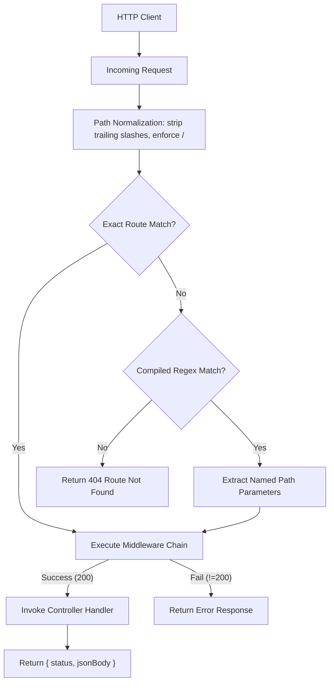
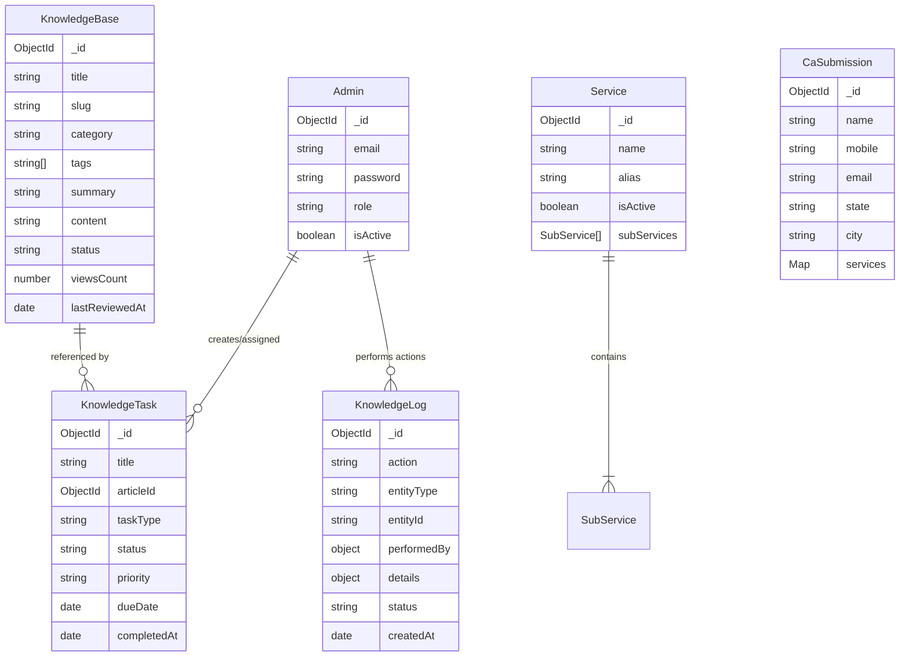

# System Architecture & Technical Specifications

---

## 1. Executive Summary

`CA-App-Be` is the backend services platform for the Chartered Accountant (CA) management system. It provides comprehensive administrative management, CA profile directories, dynamic service taxonomies, bulk CSV ingestion, notifications, WhatsApp template messaging, and Knowledge Base management.

---

## 2. Dual-Runtime Architecture

The repository currently maintains two execution environments to support a smooth migration from serverless to containerized microservices:

```
CA-App-Be Repository Root
├── src/               # Azure Functions v4 Host implementation
│   ├── config/        # Environment and database configuration
│   ├── controllers/   # Request orchestration and response formatting
│   ├── middleware/    # Auth and error middleware
│   ├── models/        # Mongoose data schemas
│   ├── routes/        # Router registration and custom pattern matcher
│   ├── services/      # Core business logic and database queries
│   └── knowledge-base/# Modular Knowledge Base package
│
└── ca-be-node/        # Standalone Node.js/Express Server (Migration Target)
    └── src/           # Direct port of src/ running on standard Node/Express
```

### Runtime Comparison

| Dimension | Azure Functions (`src/`) | Standalone Node.js (`ca-be-node/`) |
|---|---|---|
| **Runtime Host** | Azure Functions Core Tools (`func start`) | Express.js (`node src/index.js`) |
| **Port / Base URL** | `http://127.0.0.1:7071` | `http://127.0.0.1:3000` |
| **Route Prefix** | `/api/v1` | `/api/v1` |
| **Request Model** | Azure Functions v4 `HttpRequest` / `InvocationContext` | Express `req`/`res` adapted to `(request, context)` |
| **Response Model** | Plain object `{ status, jsonBody }` | Plain object `{ status, jsonBody }` converted to `res.status().json()` |
| **Timeouts** | Fixed 5 minutes ceiling in `host.json` | Configurable Node process timeout |

---

## 3. Router & Dispatch Architecture

Both runtimes utilize a shared, framework-agnostic `Router` engine:



### File Upload & Multipart Parsing
* Standard endpoints handle JSON via `request.json()`.
* Ingestion endpoints (`/ca/import`, `/ca/import/preview`) support `multipart/form-data` with hand-rolled boundary extraction and buffer parsing, supporting CSV, Excel (`.xlsx`, `.xls`), Word, and PDF files.

---

## 4. Database Schema & Data Models

Database: **MongoDB** accessed via **Mongoose ORM**.



---

## 5. Security & Authentication Model

* **JWT Verification**: Bearer token authentication via `authenticateToken` middleware.
* **Context Propagation**: Decoded user payload is attached to `context.user` containing `{ id, email, role, isActive }`.
* **Password Hashing**: Bcrypt with salt rounds for administrative credentials.
* **CORS & Headers**: Strict CORS origins and headers configured per environment.

---

## 6. Testing & Parity Framework

* **Framework**: Jest + Supertest (`test/`).
* **Environment-Agnostic Execution**: Tests execute via HTTP client against `BASE_URL`.
* **External Mocking**: `test/mocks/externalServicesServer.js` mocks WhatsApp and Email APIs.
* **In-Memory Mongo**: `mongodb-memory-server` allows self-contained, high-speed test runs.
